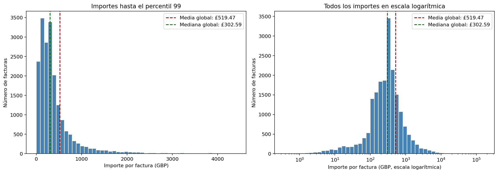
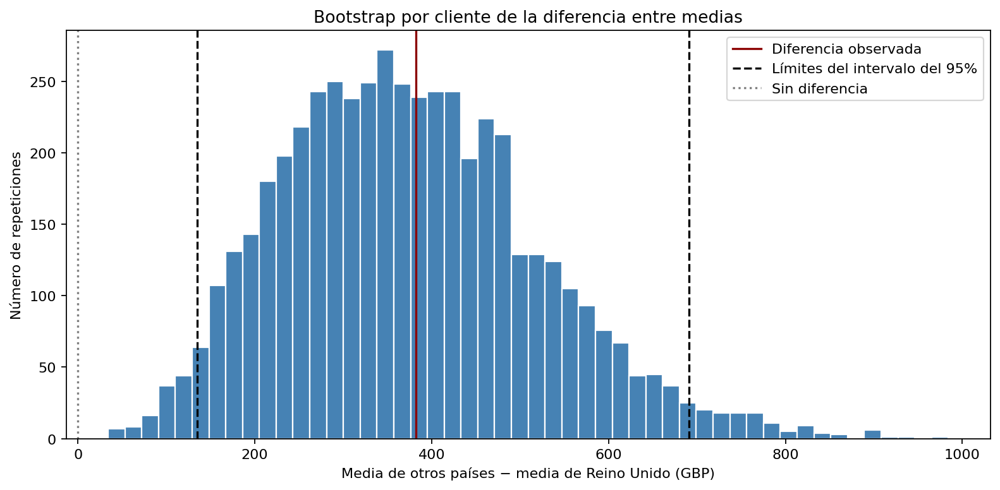

# Análisis estadístico del importe por compra

Análisis de 19.773 facturas de una tienda online británica con Python. El proyecto estudia la distribución de los importes por factura, la influencia de los pedidos grandes y las diferencias entre Reino Unido y otros países.

**Autor:** Matías Almonacid Mellado

[Ver el notebook con código, gráficos y explicaciones](purchase_statistical_analysis.ipynb)

## Resultados principales

| Indicador | Resultado |
| --- | ---: |
| Facturas analizadas | 19.773 |
| Importe medio por factura | £519,47 |
| Importe mediano por factura | £302,59 |
| Importe concentrado en las 198 facturas superiores al percentil 99 | 19,20 % |
| Reducción de la media al excluir esas facturas | 18,38 % |

La mediana cambia de £302,59 a £301,54 al excluir ese extremo superior. Esto muestra por qué conviene acompañar el promedio con medidas menos sensibles a los pedidos grandes.



Entre las facturas con cliente identificado, la diferencia de medias entre otros países y Reino Unido es de **£381,93 por factura**. Un bootstrap por cliente de 5.000 repeticiones produce un intervalo percentil del 95 % de **[£134,66, £690,81]**, bajo los supuestos del remuestreo.



## Método

1. Selección de líneas con cantidades y precios positivos; exclusión de cancelaciones y conceptos identificados como envíos, comisiones, ajustes y vales.
2. Revisión de la coherencia de cliente y país dentro de cada factura.
3. Agregación por factura y comprobación de conservación del importe total.
4. Estadística descriptiva: media, mediana, percentiles, desviación estándar y rango intercuartílico.
5. Histogramas, distribución acumulada y análisis de sensibilidad al recortar la cola superior.
6. Comparación geográfica y bootstrap estratificado por grupo, remuestreando clientes completos.

El bootstrap conserva juntas todas las facturas de un cliente. En cada repetición, la media por factura se calcula como importe total dividido entre número de facturas; no es un promedio simple de las medias de los clientes. La semilla es 42.

## Datos

Fuente: Chen, D. (2015). *Online Retail*. UCI Machine Learning Repository. [DOI: 10.24432/C5BW33](https://doi.org/10.24432/C5BW33).

- 541.909 registros originales, entre el 1 de diciembre de 2010 y el 9 de diciembre de 2011.
- 527.761 líneas seleccionadas para el análisis.
- Moneda: libras esterlinas (GBP).
- [Página del conjunto de datos](https://archive.ics.uci.edu/dataset/352/online+retail).
- Licencia de los datos: [CC BY 4.0](https://creativecommons.org/licenses/by/4.0/).

El Excel original se descarga por separado y no se incluye en el repositorio.

## Cómo ejecutar

Requiere Python 3.12 y las dependencias de `requirements.txt`.

1. Descarga este repositorio y extrae su contenido.
2. Descarga el conjunto de datos desde UCI, descomprime el archivo y coloca `Online Retail.xlsx` junto al notebook.
3. Abre una terminal en la carpeta del proyecto e instala las dependencias:

   ```bash
   python -m pip install -r requirements.txt
   ```

4. Inicia Jupyter:

   ```bash
   python -m jupyterlab
   ```

5. Abre `purchase_statistical_analysis.ipynb` y ejecuta las celdas en orden desde un kernel reiniciado.

Los gráficos se guardan en `figures/` y las tablas en `resultados/`. La tabla detallada `facturas.csv` se genera localmente; el repositorio incluye los resúmenes y la distribución bootstrap.

## Archivos

| Archivo o carpeta | Contenido |
| --- | --- |
| `purchase_statistical_analysis.ipynb` | Análisis completo y resultados ejecutados |
| `figures/` | Tres gráficos exportados |
| `resultados/` | Estadísticas, comparaciones y resultados del bootstrap |
| `requirements.txt` | Dependencias para ejecutar el análisis |

## Alcance y limitaciones

Los importes corresponden a productos facturados con cantidades y precios positivos, antes de posibles cancelaciones posteriores. No representan ingresos netos, gasto final del cliente ni ganancias.

Se conservan las filas exactamente repetidas: no hay un identificador de línea que permita confirmar que sean errores. Los recortes por percentiles son escenarios de sensibilidad, no una corrección de los datos.

El análisis descriptivo incluye facturas sin cliente identificado. El bootstrap excluye 1.371 de esas facturas y trabaja con 3.916 clientes de Reino Unido y 418 de otros países. No extrapola automáticamente sus resultados a las compras excluidas.

Las estadísticas históricas describen las facturas seleccionadas. El intervalo bootstrap es un ejercicio de inferencia que supone independencia entre clientes y representatividad de sus historiales. No modela dependencias temporales compartidas, no prueba causalidad y no predice compras futuras. El grupo de otros países reúne mercados heterogéneos.

## Verificación

Las celdas de código se ejecutaron en orden en un proceso Python limpio. Se comprobaron el número de facturas, la conservación del importe total, la ausencia de conflictos de cliente o país por factura y la reproducción del intervalo bootstrap. Esta verificación se realizó por ejecución secuencial del código, sin utilizar un kernel de Jupyter.
